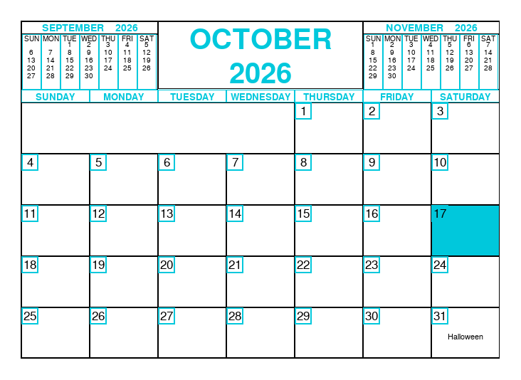
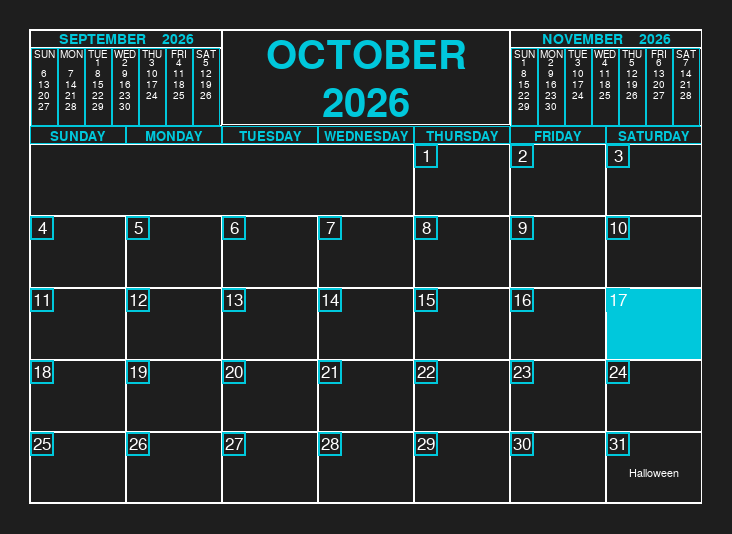

# ppc2 - Multi-featured Pretty Printable Calendar

A highly customizable, feature-rich desktop calendar app that is truly like no other. Built with Python and Pygame for fast, pixel-perfect UI rendering across platforms.




## 🌟 Key Features

* **Deep Visual Customization:** Toggle between **3 different window sizes**, **6 custom highlight color schemes**, and **Dark/Light modes** to fit your desktop aesthetic.
* **Regional Layouts:** Seamlessly switch between **USA mode** (week starts on Sunday) and **European mode** (week starts on Monday).
* **Power-User Navigation:** Built-in keyboard key bindings let you instantly advance or go back by month, year, or jump exactly **10 years at a time**.
* **Editable Holiday Integration:** Automatically loads holidays from simple, user-editable `20xxholidays.json` files. Add your own custom dates or remove the defaults with ease.
* **Spreadsheet-Style Event Entry:** Type personal events directly from your keyboard into a grid format, exactly like editing a spreadsheet.
* **100% Private & Local:** All personal events and application settings are completely local. The app requires zero cloud accounts or internet access.

> ### 💡 Need Help Using the App?
> Press **`Control + h`** at any time while the application is open to toggle the built-in **Help Menu** (`CalendarHelp.png`). Pressing it again will return you straight back to your calendar screen!

---

## 💾 Downloads & Installation

Select the package corresponding to your operating system to download the application binaries:

### 🪟 Windows
- 📥 **[Download ppc2ForWindows.zip](./ppc2ForWindows.zip)**
- **To Run:** Extract the `.zip` archive completely, open the folder, and double-click `ppc2.exe`. *(If Windows SmartScreen warns you, click "More info" -> "Run anyway".)*

### 🍏 macOS
- 📥 **[Download ppc2ForMac.zip](./ppc2ForMac.zip)**

Because this app is independently developed and distributed via GitHub (without a paid Apple Developer ID certificate), macOS Gatekeeper may flag it on first launch. You can bypass this easily using one of two methods:

#### Method 1: The Quick GUI Way (Recommended)
1. Unzip the downloaded `ppc2ForMac.zip` file to reveal `ppc2.app`.
2. **Right-click** (or hold the `Control` key and click) on `ppc2.app`.
3. Select **Open** from the context menu.
4. Click **Open** on the security warning dialog. (You only need to do this the very first time you run the app).

#### Method 2: Via Terminal (If Gatekeeper blocks it)
If macOS still blocks the app, open your **Terminal** app and run the following command to clear the download quarantine flag:
```bash
xattr -cr /path/to/ppc2.app
On my Macbook Pro I downloaded the ppc2ForMac.zip file and ran:
xattr -cr ~/Downloads/ppc2.app

### 🐧 Linux
- 📥 **[Download ppc2-x86_64.AppImage](./ppc2-x86_64.AppImage)**
- **To Run:** Make the AppImage executable and run it via terminal or file manager:
  ```bash
  chmod +x ppc2-x86_64.AppImage
  ./ppc2-x86_64.AppImage
  ```

---

## 🔒 Storage & Data Transparency

Your privacy matters. All data is kept 100% offline and localized. Your application settings and calendar entries are stored in the standard configurations paths assigned by your operating system:

* **Windows:** `~\AppData\Roaming\`
* **macOS:** `~/Library/Application Support/`
* **Linux:** `~/.local/share/` (Respects `$XDG_DATA_HOME`)

### App Data Files:
* `personal_events.json` — Stores all your typed spreadsheet calendar events.
* `ppc_config.json` — Stores your layout size, dark/light mode preference, and color scheme selections.

You can back up these specific files if you ever want to transfer your calendar data to a new computer!

---

## 💬 Feedback & Bug Reports
I am actively looking for user feedback on the UI responsiveness, keyboard navigation shortcuts, and cross-platform stability. Please feel free to open a GitHub **Issue** to share your thoughts, feature requests, or report any bugs!


  ```

